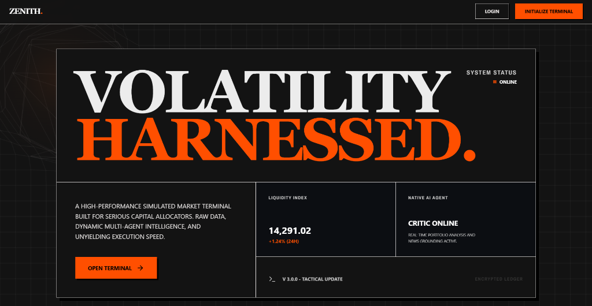
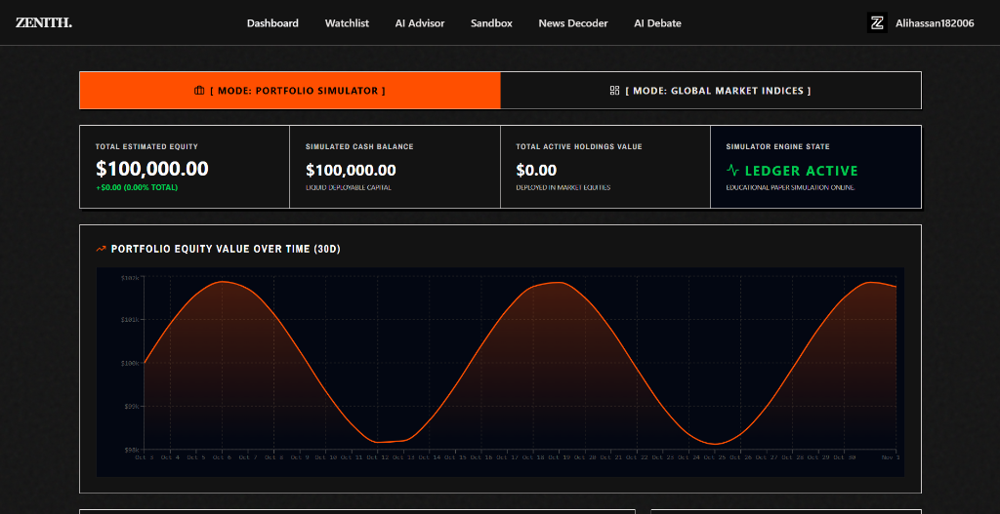
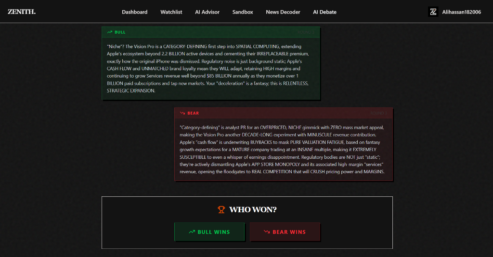
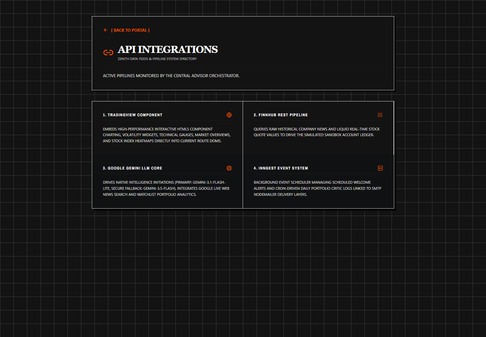

# Zenith AI

A financial-learning prototype combining market-data integrations, AI-assisted research, and paper trading with virtual funds. Built with Next.js, MongoDB, and a streaming multi-agent advisor.

## Website preview

### Public landing page



### Market dashboard & portfolio simulator



### AI debate terminal



### Integration directory




## 📄 Documentation & Deep Dives
For a deeper understanding of the platform's current state, strengths, weaknesses, and future roadmaps, please refer to:
- [System Evaluation & Architecture (`evaluation.md`)](./evaluation.md)
- [Project Insights & Future Roadmap (`insight.md`)](./insight.md)

## 🏗 System Architecture

This platform is built on three core pillars:

### 1. Main UI Shell
- **Framework:** Next.js 16 (App Router, Server Components, Turbopack)
- **Database:** MongoDB & Mongoose
- **Authentication:** `better-auth`
- **Styling:** Tailwind CSS + `shadcn/ui` + Framer Motion
- **Data Integration:** Finnhub (Raw Market Data/News) & TradingView (Interactive Charting Widgets)

### 2. AI Automation & Agents
- **AI Stock Advisor**: Powered by Vercel AI SDK, Google Gemini (`gemini-3.1-flash-lite` with `gemini-3.5-flash` fallback), and LangGraph. Features a multi-agent system (Supervisor, Technical Analyst, Sentiment Analyst) that dynamically streams thoughts and responses into a bespoke generative chat interface (`/stockadvisor`).
- **Background Intelligence**: Powered by Inngest and Google Gemini. The platform automatically generates hyper-personalized AI welcome emails upon sign-up and scheduled daily AI news summaries tailored specifically to user watchlists.

### 3. Sandbox Pillar (Paper Trading)
- **Virtual Balance:** Every user is initialized with a `$100,000` virtual balance via `better-auth` session injection.
- **Engine:** Real-time Buy/Sell execution logic that tracks portfolios and transactions, calculating average cost basis and P&L natively.

## ⚙️ Getting Started

### Prerequisites
- Node.js >= 18
- MongoDB instance (Atlas or local)

### Installation

1. **Clone & Install**
   ```bash
   npm install --legacy-peer-deps
   ```

2. **Environment Variables**
   Copy `.env.example` to `.env.local` and fill in your keys:
   ```bash
   cp .env.example .env.local
   ```
   *Required Keys:*
   - `MONGODB_URI`: Database connection
   - `BETTER_AUTH_SECRET` & `BETTER_AUTH_URL`: Authentication
   - `GEMINI_API_KEY`: Google Gemini API Key powering LangGraph AI Advisor and Inngest Background Tasks
   - `NEXT_PUBLIC_FINNHUB_API_KEY` & `FINNHUB_API_KEY`: Real-time Market Data
   - `NODEMAILER_EMAIL` & `NODEMAILER_PASSWORD`: Transactional Emails

3. **Run the Development Server**
   ```bash
   npm run dev
   ```
   Navigate to `http://localhost:3000` to start exploring!
